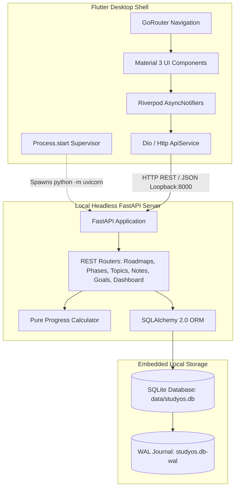
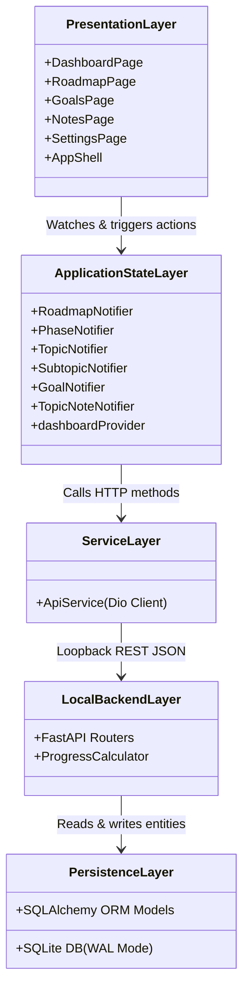
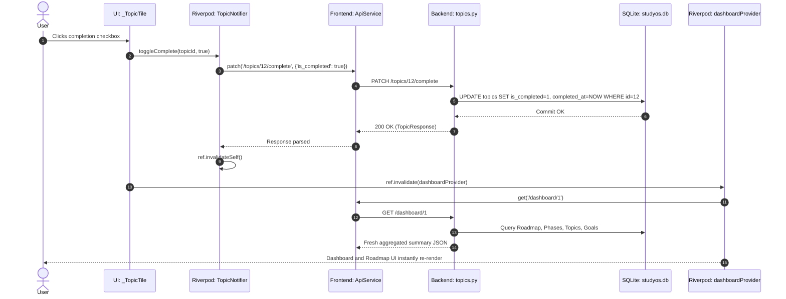
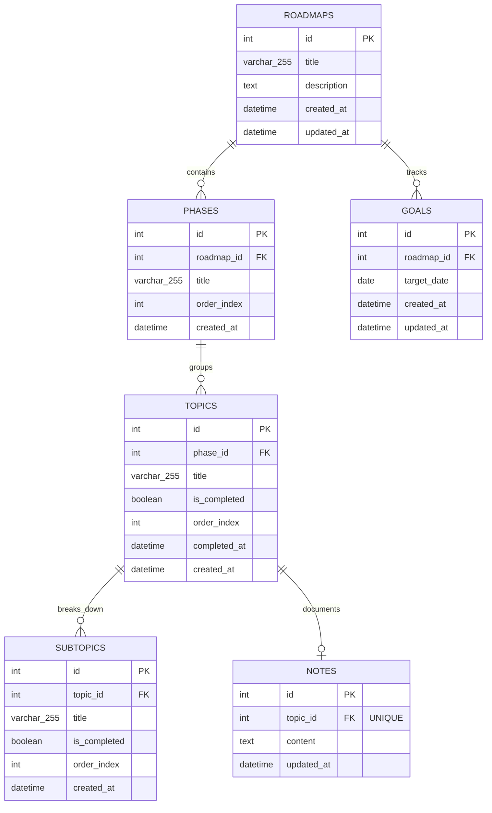

# StudyOS — Architecture Specification

> **Document Version:** 1.0.0  
> **Status:** Verified Active Architecture  
> **Project Root:** `StudyOS`  
> **Target Release:** Version 1.0 (MVP)

---

## 1. System Overview

**StudyOS** is a local-first, single-user desktop learning management environment designed to help self-directed learners organize hierarchical study roadmaps, track daily progress, maintain study pacing toward target deadlines, and record context-linked Markdown notes.

### Architectural Archetype
StudyOS adopts a **Split-Process Desktop Client-Server Architecture**:
1. **Frontend Presentation Shell:** A desktop native UI built with **Flutter Desktop (Windows/Linux)** utilizing **Riverpod** for reactive state management and **GoRouter** for URL-like internal routing.
2. **Local Headless Service:** A high-performance local micro-service built with **Python FastAPI** and **Uvicorn**, serving as the authoritative business logic and persistence engine over standard HTTP REST (`127.0.0.1:8000`).
3. **Storage Engine:** An embedded **SQLite** relational database operating in **WAL (Write-Ahead Logging)** mode via **SQLAlchemy 2.0 ORM**, with strictly enforced foreign key constraints and cascading deletions.
4. **Inter-Process Communication (IPC):** Lightweight REST requests over loopback TCP (`http://127.0.0.1:8000`). The Flutter client automatically manages the lifecycle of the Python subprocess on launch and shutdown.



---

## 2. Actual Technology Stack

The following stack represents the **actual, audited codebase dependencies** discovered in configuration files (`pubspec.yaml`, `requirements.txt`) and runtime verification:

| Layer | Component | Specified Technology | Verified Version | Source Manifest |
|---|---|---|---|---|
| **Runtime Environment** | OS Platform | Windows 10/11 x64, Linux | Windows 10.0.26200 | Host OS |
| **Frontend Framework** | UI Engine | Flutter Desktop | Flutter 3.44.0 (Dart 3.12.0) | `frontend/pubspec.yaml` |
| **Frontend State** | State Management | Flutter Riverpod | 2.6.1 | `frontend/pubspec.yaml` |
| **Frontend Navigation** | Declarative Router | GoRouter | 14.8.1 | `frontend/pubspec.yaml` |
| **Frontend Networking** | HTTP Client | Dio | 5.10.0 | `frontend/pubspec.yaml` |
| **Frontend Markdown** | Rich Viewer | flutter_markdown | 0.7.7+1 | `frontend/pubspec.yaml` |
| **Frontend Typography** | Typography | google_fonts (Inter) | 6.3.3 | `frontend/pubspec.yaml` |
| **Backend Framework** | Web Microframework | FastAPI | 0.115.5 | `backend/requirements.txt` |
| **Backend ASGI** | Web Server | Uvicorn (standard) | 0.32.1 | `backend/requirements.txt` |
| **Data Access / ORM** | Object Relational Mapper | SQLAlchemy | 2.0.36 | `backend/requirements.txt` |
| **Data Validation** | Schema Definition | Pydantic V2 | 2.10.3 | `backend/requirements.txt` |
| **Database Engine** | Embedded Relational | SQLite (WAL mode) | 3.x | Python standard library |
| **Date Arithmetic** | Utilities | python-dateutil | 2.9.0 | `backend/requirements.txt` |
| **Database Migrations** | Tooling | Alembic | 1.14.0 | `backend/requirements.txt` |

---

## 3. Existing Folder Structure

```
StudyOS/
├── backend/                             # Local Python FastAPI Service
│   ├── models/                          # SQLAlchemy ORM Database Models
│   │   ├── __init__.py                  # Model exports
│   │   ├── goal.py                      # Goal model (target_date, roadmap_id)
│   │   ├── note.py                      # Note model (topic_id, content, markdown)
│   │   ├── phase.py                     # Phase model (roadmap_id, order_index)
│   │   ├── roadmap.py                   # Roadmap model (title, description)
│   │   ├── subtopic.py                  # Subtopic model (topic_id, is_completed)
│   │   └── topic.py                     # Topic model (phase_id, is_completed, order_index)
│   ├── routers/                         # FastAPI REST Endpoints
│   │   ├── __init__.py                  # Router module definitions
│   │   ├── dashboard.py                 # Aggregated stats & today's focus endpoint
│   │   ├── goals.py                     # Goal CRUD endpoints
│   │   ├── notes.py                     # Note upsert & retrieval endpoints
│   │   ├── phases.py                    # Phase CRUD endpoints
│   │   ├── roadmaps.py                  # Roadmap CRUD endpoints
│   │   ├── subtopics.py                 # Subtopic CRUD & toggle endpoints
│   │   └── topics.py                    # Topic CRUD & toggle-complete endpoints
│   ├── schemas/                         # Pydantic V2 Request/Response Schemas
│   │   ├── __init__.py                  # Schema exports
│   │   ├── goal.py                      # GoalCreate, GoalUpdate, GoalResponse
│   │   ├── note.py                      # NoteUpsert, NoteResponse
│   │   ├── phase.py                     # PhaseCreate, PhaseUpdate, PhaseResponse
│   │   ├── roadmap.py                   # RoadmapCreate, RoadmapUpdate, RoadmapResponse
│   │   ├── subtopic.py                  # SubtopicCreate, SubtopicUpdate, SubtopicResponse
│   │   └── topic.py                     # TopicCreate, TopicUpdate, TopicResponse
│   ├── utils/                           # Business Logic Utilities
│   │   ├── __init__.py
│   │   └── progress_calculator.py       # Pure calculation functions (no DB coupling)
│   ├── database.py                      # SQLAlchemy engine, session maker, WAL pragma
│   ├── main.py                          # FastAPI entrypoint, CORS, startup handlers
│   ├── requirements.txt                 # Backend Python dependencies
│   └── test_api.py                      # API smoke test script
├── data/                                # Local Database Persistence Directory
│   ├── .gitkeep                         # Git tracking placeholder (DB is gitignored)
│   └── studyos.db                       # Runtime SQLite database file
├── frontend/                            # Flutter Desktop Application
│   ├── lib/
│   │   ├── app.dart                     # MaterialApp.router configuration
│   │   ├── main.dart                    # Flutter entrypoint, process supervisor
│   │   ├── core/                        # Global App Constants & Theme
│   │   │   ├── constants/
│   │   │   │   └── api_constants.dart   # Base URL (http://127.0.0.1:8000)
│   │   │   ├── router/
│   │   │   │   └── app_router.dart      # GoRouter route definitions & ShellRoute
│   │   │   └── theme/
│   │   │       └── app_theme.dart       # AppColors, Material 3 Dark & Light themes
│   │   ├── features/                    # Feature-Driven Modules
│   │   │   ├── dashboard/               # Dashboard Feature Module
│   │   │   │   ├── application/
│   │   │   │   │   └── dashboard_provider.dart
│   │   │   │   ├── domain/
│   │   │   │   │   └── dashboard_summary.dart
│   │   │   │   └── presentation/
│   │   │   │       └── dashboard_page.dart
│   │   │   ├── goals/                   # Goals Feature Module
│   │   │   │   ├── application/
│   │   │   │   │   └── goals_provider.dart
│   │   │   │   ├── domain/
│   │   │   │   │   └── goal_model.dart
│   │   │   │   └── presentation/
│   │   │   │       └── goals_page.dart
│   │   │   ├── notes/                   # Notes Feature Module
│   │   │   │   ├── application/
│   │   │   │   │   └── notes_provider.dart
│   │   │   │   ├── domain/
│   │   │   │   │   └── note_model.dart
│   │   │   │   └── presentation/
│   │   │   │       └── notes_page.dart
│   │   │   ├── roadmap/                 # Roadmap Feature Module
│   │   │   │   ├── application/
│   │   │   │   │   └── roadmap_provider.dart
│   │   │   │   ├── domain/
│   │   │   │   │   └── roadmap_models.dart
│   │   │   │   └── presentation/
│   │   │   │       └── roadmap_page.dart
│   │   │   └── settings/                # Settings Feature Module
│   │   │       └── presentation/
│   │   │           └── settings_page.dart
│   │   └── shared/                      # Reusable Cross-Feature Components
│   │       ├── services/
│   │       │   └── api_service.dart     # Dio HTTP client wrapper with error handling
│   │       └── widgets/
│   │           ├── app_shell.dart       # Fixed sidebar layout wrapper
│   │           └── progress_bar.dart    # Custom animated progress bar
│   ├── test/
│   │   └── widget_test.dart             # Flutter smoke widget test
│   ├── pubspec.yaml                     # Flutter package dependencies
│   └── pubspec.lock                     # Locked Flutter dependency tree
├── .gitignore                           # Git ignore rules (ignores data/*.db, build/)
└── README.md                            # High-level product overview
```

---

## 4. Application Entry Points

### 4.1 Backend Entry Point: `backend/main.py`
The backend service boots via `uvicorn main:app --host 127.0.0.1 --port 8000`.
- **Startup Lifecycle (`@app.on_event("startup")`):** Calls `init_db()` from `database.py`, triggering `Base.metadata.create_all(bind=engine)` which guarantees all SQLite tables exist prior to handling any inbound requests.
- **Middleware:** Installs permissive `CORSMiddleware` (`allow_origins=["*"]`) to allow standard local browser and desktop HTTP access.
- **Routers Registered:** Mounts prefixes `/roadmaps`, `/phases`, `/topics`, `/subtopics`, `/notes`, `/goals`, and `/dashboard`.
- **Health Check Endpoint:** Exposes `GET /health` returning `{"status": "ok", "version": "1.0.0"}` used by the Flutter client to detect backend readiness.

### 4.2 Frontend Entry Point: `frontend/lib/main.dart`
- **Widgets Binding:** Executes `WidgetsFlutterBinding.ensureInitialized()`.
- **API Service Initialization:** Configures the singleton `ApiService` with `http://127.0.0.1:8000`.
- **Subprocess Supervisor:**
  1. Checks `await ApiService().isHealthy()` via `GET /health`.
  2. If unreachable, locates the `backend/` directory relative to current runtime path (`Directory.current`).
  3. Executes `Process.start('python', ['-m', 'uvicorn', 'main:app', '--host', '127.0.0.1', '--port', '8000'], workingDirectory: backendPath)`.
  4. Pipes subprocess standard output and error to Flutter debug console.
  5. Waits 1500ms for loopback port binding before mounting the root widget.
- **Root Widget:** Mounts `ProviderScope(child: StudyOsApp())`.

---

## 5. Architectural Responsibilities



1. **Presentation Layer (`frontend/lib/features/*/presentation/`):** Purely declarative Material 3 widgets. Contains no direct SQL, no business calculation logic, and no direct file system operations. Interacts exclusively with Riverpod providers.
2. **Application State Layer (`frontend/lib/features/*/application/`):** Subclasses of Riverpod's `AsyncNotifier` or `FamilyAsyncNotifier`. Handles asynchronous communication, manages optimistic or invalidated states, and updates presentation subscribers.
3. **Network Service Layer (`frontend/lib/shared/services/api_service.dart`):** Wraps `Dio` with standard timeout thresholds (5s connect, 5s receive), JSON serialization, and unified `StudyOsApiException` error extraction.
4. **Backend Routing Layer (`backend/routers/`):** Validates HTTP payload models using Pydantic, controls database transactions, and converts ORM entities into serialized JSON representations.
5. **Business Calculation Layer (`backend/utils/progress_calculator.py`):** Pure mathematical functions decoupled from database connections. Calculates percentages, topic deltas, days remaining, required daily pace, and next focus items.
6. **Persistence Layer (`backend/models/`, `backend/database.py`):** Defines database tables, foreign keys, cascades, indices, and connection connection pooling/pragmas.

---

## 6. Runtime Data & Request Flow

### 6.1 Complete Topic Workflow Flow


---

## 7. Database Schema & Entity Relationships

The database schema strictly adheres to a **4-tier learning hierarchy**:
$$\text{Roadmap} \longrightarrow \text{Phase} \longrightarrow \text{Topic} \longrightarrow \text{Subtopic}$$
Additionally, **Goals** are linked 1-to-N to Roadmaps, and **Notes** are linked 1-to-1 to Topics.



### Table Specifications & Constraints

#### Table: `roadmaps`
| Column | Type | Constraints | Description |
|---|---|---|---|
| `id` | INTEGER | PRIMARY KEY, AUTOINCREMENT | Unique roadmap identifier |
| `title` | VARCHAR(255) | NOT NULL | Human-readable curriculum title |
| `description` | TEXT | NULLABLE | Detailed roadmap objective/scope |
| `created_at` | DATETIME | DEFAULT utcnow | Creation timestamp |
| `updated_at` | DATETIME | DEFAULT utcnow, onupdate | Last modification timestamp |

#### Table: `phases`
| Column | Type | Constraints | Description |
|---|---|---|---|
| `id` | INTEGER | PRIMARY KEY, AUTOINCREMENT | Unique phase identifier |
| `roadmap_id` | INTEGER | NOT NULL, FOREIGN KEY (`roadmaps.id`) ON DELETE CASCADE | Parent roadmap reference |
| `title` | VARCHAR(255) | NOT NULL | Phase title (e.g., "Phase 1: Fundamentals") |
| `order_index` | INTEGER | NOT NULL, DEFAULT 0 | Sequential display order |
| `created_at` | DATETIME | DEFAULT utcnow | Creation timestamp |

#### Table: `topics`
| Column | Type | Constraints | Description |
|---|---|---|---|
| `id` | INTEGER | PRIMARY KEY, AUTOINCREMENT | Unique topic identifier |
| `phase_id` | INTEGER | NOT NULL, FOREIGN KEY (`phases.id`) ON DELETE CASCADE | Parent phase reference |
| `title` | VARCHAR(255) | NOT NULL | Topic title |
| `is_completed`| BOOLEAN | NOT NULL, DEFAULT FALSE | Completion checkbox state |
| `order_index` | INTEGER | NOT NULL, DEFAULT 0 | Sequential display order |
| `completed_at`| DATETIME | NULLABLE | Timestamp when marked completed |
| `created_at` | DATETIME | DEFAULT utcnow | Creation timestamp |

#### Table: `subtopics`
| Column | Type | Constraints | Description |
|---|---|---|---|
| `id` | INTEGER | PRIMARY KEY, AUTOINCREMENT | Unique subtopic identifier |
| `topic_id` | INTEGER | NOT NULL, FOREIGN KEY (`topics.id`) ON DELETE CASCADE | Parent topic reference |
| `title` | VARCHAR(255) | NOT NULL | Granular checklist item title |
| `is_completed`| BOOLEAN | NOT NULL, DEFAULT FALSE | Subtopic completion checkbox |
| `order_index` | INTEGER | NOT NULL, DEFAULT 0 | Sequential display order |
| `created_at` | DATETIME | DEFAULT utcnow | Creation timestamp |

#### Table: `notes`
| Column | Type | Constraints | Description |
|---|---|---|---|
| `id` | INTEGER | PRIMARY KEY, AUTOINCREMENT | Unique note identifier |
| `topic_id` | INTEGER | NOT NULL, UNIQUE, FOREIGN KEY (`topics.id`) ON DELETE CASCADE | 1-to-1 link to topic |
| `content` | TEXT | DEFAULT "" | Raw Markdown note text |
| `updated_at` | DATETIME | DEFAULT utcnow, onupdate | Auto-save modification timestamp |

#### Table: `goals`
| Column | Type | Constraints | Description |
|---|---|---|---|
| `id` | INTEGER | PRIMARY KEY, AUTOINCREMENT | Unique goal identifier |
| `roadmap_id` | INTEGER | NOT NULL, FOREIGN KEY (`roadmaps.id`) ON DELETE CASCADE | Target roadmap |
| `target_date` | DATE | NOT NULL | Desired completion date (YYYY-MM-DD) |
| `created_at` | DATETIME | DEFAULT utcnow | Creation timestamp |
| `updated_at` | DATETIME | DEFAULT utcnow, onupdate | Last adjustment timestamp |

### Architectural Invariant: Zero Stored Progress Columns
Notice that neither `roadmaps` nor `phases` contain columns like `progress_percent`, `completed_count`, or `total_count`.
- **Reason:** Storing computed progress creates synchronization hazards, duplicate update transactions, and race conditions.
- **Implementation:** All progress numbers are calculated dynamically on read in `progress_calculator.py` by aggregating `is_completed` counts across child topics.

---

## 8. State Management & Invalidation Behavior

State is managed via **Riverpod 2.6.1** following the `AsyncNotifier` pattern:
- **`selectedRoadmapIdProvider` (`StateProvider<int?>`):** Central source of truth for the active roadmap across the application.
- **`roadmapNotifierProvider` (`AsyncNotifierProvider<RoadmapNotifier, List<RoadmapModel>>`):** Manages roadmap lists, additions, edits, and deletions.
- **`phaseNotifierProvider` (`AsyncNotifierProviderFamily<PhaseNotifier, List<PhaseModel>, int>`):** Scoped per `roadmapId`.
- **`topicNotifierProvider` (`AsyncNotifierProviderFamily<TopicNotifier, List<TopicModel>, int>`):** Scoped per `phaseId`.
- **`subtopicNotifierProvider` (`AsyncNotifierProviderFamily<SubtopicNotifier, List<SubtopicModel>, int>`):** Scoped per `topicId`.
- **`topicNoteNotifierProvider` (`AsyncNotifierProviderFamily<TopicNoteNotifier, NoteModel?, int>`):** Scoped per `topicId`. Includes a `Timer? _debounceTimer` that enforces a **500ms debounce** on text input before firing HTTP PUT updates.
- **`dashboardProvider` (`FutureProvider.autoDispose<DashboardSummary?>`):** Watches `selectedRoadmapIdProvider` and automatically fetches aggregated stats.

### Invalidation Cascade
When an entity is modified (e.g. topic toggled, phase added, goal set), notifiers call `ref.invalidateSelf()` and the calling UI invalidates `dashboardProvider`. This guarantees that navigating back to Dashboard or Goals immediately presents updated calculations without manual page reloading.

---

## 9. Theme & Configuration Handling

### Theme Architecture
Themes are centralized in `frontend/lib/core/theme/app_theme.dart`:
- **`AppColors`:** Palette defining Dark Canvas (`#0F0F13`), Dark Surface (`#1A1A24`), Dark Card (`#22222E`), Dark Border (`#2E2E3E`), Primary Indigo (`#6366F1`), Accent Cyan (`#06B6D4`), Status Success (`#10B981`), Warning (`#F59E0B`), and Error (`#EF4444`).
- **`AppTheme.dark()`:** Material 3 dark configuration with custom `GoogleFonts.interTextTheme`.
- **`AppTheme.light()`:** Fully implemented Material 3 light configuration with light canvas (`#F5F5FA`) and surface (`#FFFFFF`).
- **Current Limitation:** In `app.dart:15`, `themeMode: ThemeMode.dark` is hardcoded. The switch in `SettingsPage` currently lacks a backing `ThemeMode` provider.

---

## 10. Error Handling & Validation Architecture

1. **Backend Validation:** Handled automatically by Pydantic schemas (`schemas/*.py`). Input with missing non-nullable fields or invalid types triggers an immediate `422 Unprocessable Entity` response with structured error messages.
2. **Backend Entity Lookup:** All router operations verify entity existence via `db.get()`. If not found, a clean `HTTPException(status_code=404, detail="Entity not found")` is returned.
3. **Frontend Error Encapsulation:** `ApiService` intercepts Dio errors and maps HTTP non-2xx responses into typed exceptions.
4. **UI Failure States:** Riverpod `.when(data: ..., loading: ..., error: ...)` handlers wrap every async view, preventing UI crashes and rendering informative error text.

---

## 11. Testing Architecture

1. **Pure Function Tests (`backend/utils/progress_calculator.py`):**
   - Zero topic calculation safety (no division-by-zero errors).
   - Past target date overdue calculation.
   - Target date today handling.
   - Pacing calculation precision.
2. **Database Integration Tests (`backend/database.py`, `backend/models/`):**
   - In-memory SQLite verification of foreign key enforcement (`PRAGMA foreign_keys=ON`).
   - Cascade deletion verification: Deleting a roadmap automatically cascades to delete all linked phases, topics, subtopics, notes, and goals.
3. **Frontend Smoke & Widget Tests (`frontend/test/widget_test.dart`):**
   - Verifies root `StudyOsApp` widget mounting under `ProviderScope`.
   - Confirms application boots without throwing framework exceptions.

---

## 12. Build and Run Instructions

### Prerequisites
- Python 3.10+ (tested on Python 3.13)
- Flutter SDK 3.27+ (tested on Flutter 3.44.0 stable)
- Visual Studio 2022 C++ Build Tools & Windows 10/11 SDK (for Windows Desktop compilation)

### Method A: Dual-Terminal Development Run (Recommended)
**Terminal 1 — Backend Service:**
```bash
cd backend
pip install -r requirements.txt
python -m uvicorn main:app --host 127.0.0.1 --port 8000 --reload
```
*Verify backend:* Visit `http://127.0.0.1:8000/docs` to inspect Swagger API docs.

**Terminal 2 — Frontend Desktop Application:**
```powershell
cd frontend
flutter pub get
flutter run -d windows
```

### Method B: Standalone Flutter Auto-Launch
```powershell
cd frontend
flutter run -d windows
```
*Note:* The Flutter app checks if port 8000 is active; if not, `main.dart` launches Python Uvicorn as a background child process.

---

## 13. Architectural Limitations & Technical Debt

1. **Subprocess Termination on Windows:** In `main.dart`, `Process.start` launches Uvicorn. While standard shutdown terminates child processes, abrupt Flutter window termination (e.g. killing the task via task manager) can leave orphan Python processes bound to port 8000.
2. **Single Roadmap Global State:** `selectedRoadmapIdProvider` holds a single nullable ID in memory. It is not currently persisted to local storage (`SharedPreferences`), meaning the app always defaults to the first roadmap upon restart.
3. **Settings State Disconnection:** The Dark/Light theme switch and Database Clean Reset buttons in `SettingsPage` have placeholder callbacks without active logic.
4. **Markdown Rendering Performance:** Note content is re-rendered on every edit keystroke when toggling into preview mode. For extremely large notes (>50KB), an AST caching mechanism will be required.

---

## 14. Recommended Extension Points

1. **Local AI / LLM Extension Point (`backend/routers/ai.py`):** The clean separation between FastAPI and Flutter allows dropping in local LLM endpoints (via Ollama or Llama-cpp) without restructuring the frontend state machine.
2. **Search Index Extension Point:** SQLite `FTS5` (Full Text Search) virtual tables can be attached to `notes.content` and `topics.title` to provide instant search across all roadmaps.
3. **Data Import/Export Service (`backend/routers/backup.py`):** A single JSON export/import router can be wired to serialize all tables into an encrypted backup bundle.
